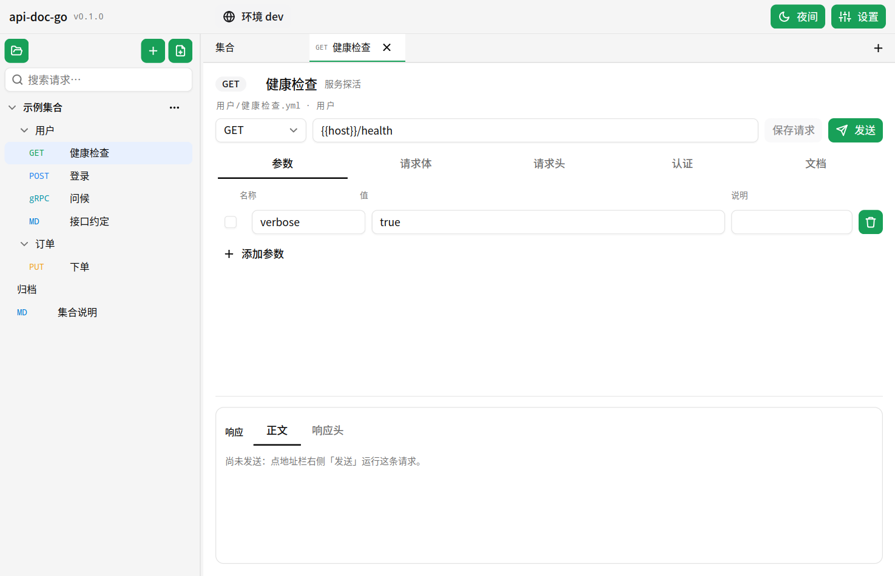
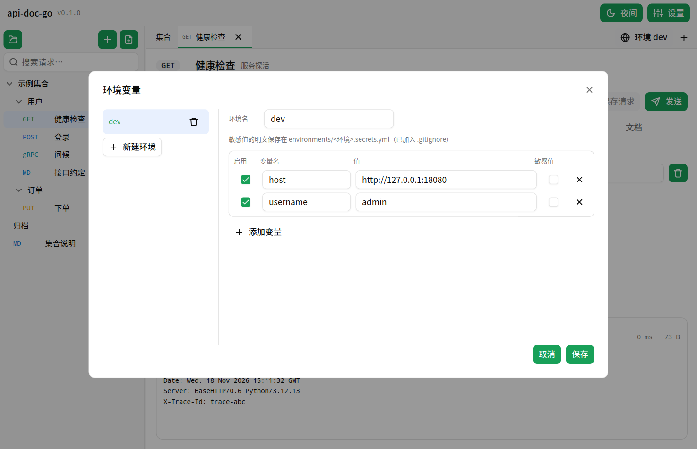
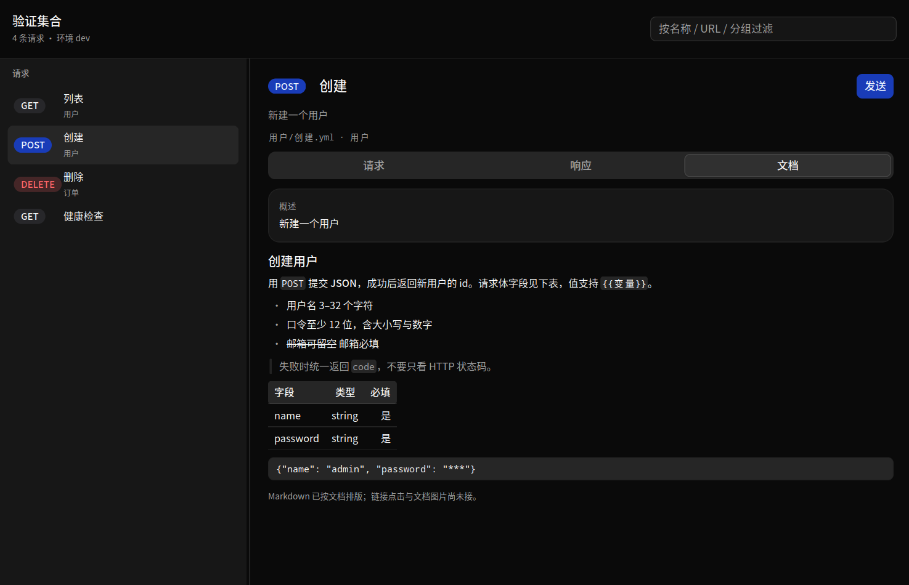
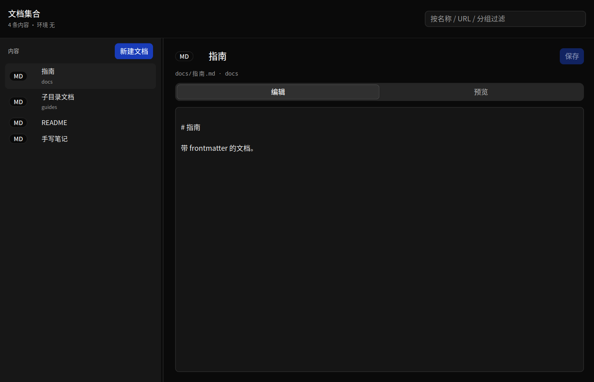
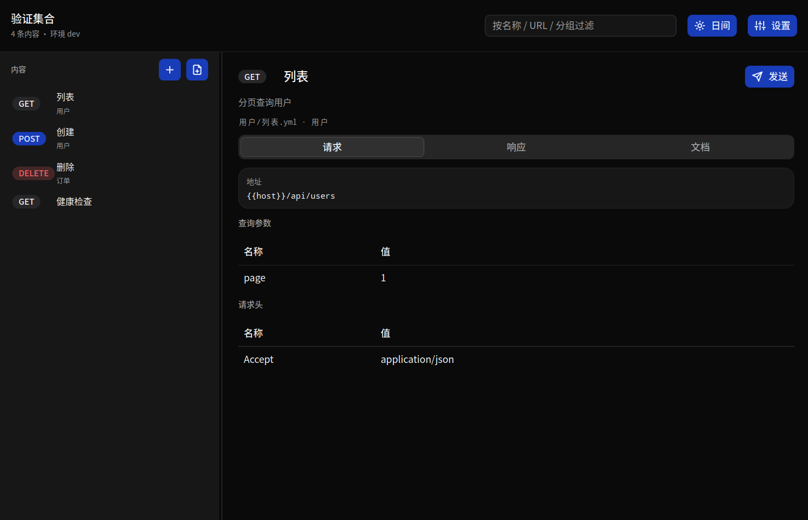

# api-doc-go-viva

用 [Viva](https://github.com/vivaui/viva)（Go 优先、原生 GPU 绘制的桌面框架，无 WebView）复刻
api-doc-go 桌面客户端的**可行性验证版**：同一份集合文件、同一个 Go 内核，界面换成 Viva 的原生窗口。

**结论：可行。** 集合格式与 HTTP 执行层可以原样复用（`api-doc-go-share/collection`），
界面层用 Viva 的声明式 API 写出来是普通 Go 代码，无头测试能完整驱动「点行 → 点发送 → 断言响应」。















## 这个验证版做了什么

| 能力 | 说明 |
|---|---|
| 读集合 | 复用 `share/collection` 解析 `opencollection.yml`、`folder.yml`、请求文件与环境变量（含 `*.secrets.yml`）；缺清单一律 `ErrNeedsInit`，与客户端同一条闸门 |
| 集合概览 | 固定「集合」页：目录 / 请求 / 变量环境 / 存储格式四张等宽卡片，加新建请求 / 新建文档 / 打开集合 / 设置四个动作 |
| 集合树 | 一个 `ui.Tree` 装下**多个集合根**：根按打开顺序排列、可展开 / 收起，下面是嵌套分组（含空目录）与条目；请求显示方法色标（GET 绿 / POST 蓝 / PUT 橙 / DELETE 红），文档显示 `MD`；分组按 `seq` 再按名称排序；搜索「搜索请求…」过滤时保留祖先、强制展开命中的枝干；根行「更多」菜单可新建请求 / 文档或关闭集合，分组右键可「在该分组新建请求」；同时打开多个集合时各留自己的环境与过滤词（选中项随标签走） |
| 界面配色 | 令牌对齐 `ui_reference`：窗口/侧栏 `#f5f5f5`/`#17181a`、面板 `#ffffff`/`#1e1f22`、描边 `#e3e3e3`/`#2b2d31`、选中行 `#e8f0fe`/`#16283d`、行悬停 `#ececec`/`#26282c`；方法色用 `--app-method-*` 的浅/暗成对值 |
| 尺寸 | 侧栏 260、树行 30、标签栏高 37（字号 12.5、选中白底 + 绿色下划线）、标题栏 44、控件圆角 6 |
| 标题栏 | 左上只放产品名与版本（`api-doc-go v0.1.0`）；环境下拉放在标题栏右列，左边缘与请求页内容对齐，同排还有日间/夜间与设置 |
| 标签溢出 | 标签固定宽 132；超出内容区宽度时出现「‹ ›」滚动按钮，切换标签会自动把它滚进可视区 |
| 多标签 | 顶部固定「集合」页（概览），后面是每个已打开条目；标签各留自己的草稿、页签、响应与 Markdown 缓存，互不串台；在途请求的结果回到发起它的标签；关闭按钮关标签，全关后回到概览；标签栏右侧「+」新建**临时请求**（不落盘、可直接发送，保存时走「另存为」并自动关闭临时标签）；切换集合根时标签清空 |
| 请求编辑 | 排版对齐 Wails：标题（名称 + 概述）→ 地址栏（方法 + 地址，**紧跟**「保存请求」「发送」）→ 下划线分段「参数 / 请求体 / 请求头 / 认证 / 文档」→ 下方常驻响应区（可拖拽分隔条）。参数、请求头、form / multipart 都是表格式编辑（启用勾选、行内说明、底部添加行，multipart 多一列 text/file）；保存写回原文件，`meta`、`settings`、未知字段与 `body.fields` 原样保留 |
| 快捷键 | Ctrl/Cmd+S 保存请求（文档编辑页也是保存文档）、Ctrl/Cmd+Enter 发送 |
| 环境变量 | 标签栏右侧「环境 dev ▾」菜单：列出环境（当前项打勾）、「环境设置…」打开**环境变量弹窗**——左侧环境列表（选中高亮、垃圾桶删除）、新建环境、右侧「环境名」（改名即重命名主文件与密钥文件）、变量表（启用 / 变量名 / 值 / **敏感值**）；敏感值写 `environments/<名>.secrets.yml`、主文件只留标记，普通值写主文件（0600）；删除环境把两个文件都移进 `.trash/`；选中的环境按集合根记进偏好，发送立即使用 |
| 真实发送 | `{{变量}}` 替换（含 `$uuid`/`$timestamp`）、basic/bearer/apikey、json/text/form/**multipart**（`file` 行按集合根解析路径）正文、超时与 `insecureSsl`、状态码/耗时/体积/响应体/响应头 |
| 请求文档 | Docs 用 `markdown` 解析 + `components.MarkdownView` 排版：标题、列表、引用、行内代码、表格、代码块；排版结果按「源文本 + 可用宽度」缓存，绘制只画不算 |
| Markdown 条目 | 集合里的 `.md` 也是树里的条目（子目录 README 除外，与客户端同规则）；`MD` 角标、分组/`seq` 排序一致 |
| 新建文档 | 集合树上的「新建文档」→ 与客户端同样的 `docs/` 默认位、`新建文档` 默认名、重名自动 `-2`，绝不覆盖；随后重扫并选中新文件 |
| 新建请求 | 弹窗填名称 / 方法 / 地址，落进当前选中条目所在分组（根目录则落根）；默认值与客户端一致（`Content-Type: application/json`、一行空参数、`body.type: none`），重名 `-2` |
| 集合树操作 | 右键菜单：新建请求、新建文档、重命名（只改显示名，文件名不动）、删除到回收站（`<集合>/.trash/<时间戳>.<文件名>`，与客户端同一个回收站） |
| 主题 | **默认日间模式**，工具条「日间 / 夜间」即时切换（Markdown 配色一起换）；主色对齐 Wails 的绿色（浅色 `#18a058` / 暗色 `#36ad6a`，按钮文字白色，文本选区用同色系浅底）；偏好写 `~/.config/api-doc-viva/settings.json`，下次启动沿用 |
| 打开集合 | 工具条「打开集合」走系统目录选择框（portal / zenity），失败可手输路径；**缺 `opencollection.yml` 一律先确认再初始化**，取消则不载入、不写盘；打开成功后记住目录，下次启动自动恢复 |
| 设置 | 外观（主题）、默认超时（秒）、是否跟随重定向、集合路径 / 当前环境 / 输入法状态；偏好落 `settings.json`（环境管理已从设置移出） |
| 编辑 / 预览 | 「编辑」是 `ui.TextArea`，「预览」是同一个 Markdown 渲染器；Ctrl+S 或「保存」原子写回，frontmatter 原样保留；未保存有提示，切走再回来草稿还在 |
| gRPC | 只读展示 target/service/method/proto/message（发送不在本次验证范围） |

## 界面用的组件（Viva 组件目录）

界面不是手绘样式，而是组件目录 + 声明式页面的组合：

| 位置 | 用的东西 | 说明 |
|---|---|---|
| 方法角标 | `components.PaintBadge`（Default / Secondary / Destructive / Outline） | 读用次要色、写用主色、删用危险色、gRPC 用描边 |
| 集合树 | `ui.Tree`（缩进 / 箭头 / 键盘 / 虚拟化） | 可见行由模型摊平，`TreeNode.Selected` 决定高亮；点行选中、点箭头或分组行展开收起、回车选择 |
| 树行 | `ui.Text` + `ui.ContextMenu` + `ui.Menu` | 方法列等宽着色，名称用 `LabelFor(Tree.RowID)` 让整行可点、右键出菜单；根行右侧「更多」用点击式 `ui.Menu` |
| 标签条 | `ui.Row` + `ui.Button`（关闭用 `IconX`） | 每个已打开条目一个标签；当前标签有底色与描边，关闭按钮只画图标但保留无障碍名 |
| 请求分段 | `ui.Tabs` | 参数 / 请求体 / 请求头 / 认证 / 文档；点击即写回模型，键盘方向键可用 |
| 响应分段 | `ui.Tabs` | 正文 / 响应头；响应头用等宽 `Paragraph`，拼一次文本、绘制期只画 |
| 参数表、请求头表、请求体字段表 | `ui.Table` + `ui.TableRows`（表头 / 斑马纹 / 选中 / 横向滚动） | 列宽与表头是包级常量，不再逐帧拼切片 |
| 卡片底 | `components.Card` | 地址块、正文块、文档块统一走同一套背景/边框/阴影 |
| 空状态 | `components.Empty` | 未选中、无匹配、尚未发送、gRPC 无响应 |
| 响应状态行 | 主题色 + 等宽字号 | 状态码按 2xx/4xx 取绿/红，右侧是耗时与体积；正文用 `Paragraph` 等宽滚动 |
| 接口文档 | `markdown.Document` + `components.MarkdownView` | Layout 只在源文本或宽度变化时重排，Paint 每帧复用；配色来自 `MarkdownLookFor(theme)` |
| 文档编辑 | `ui.TextArea` + `ui.Shortcut(Ctrl+S)` | 编辑与预览同一份内容，预览实时跟随；脏状态与保存状态在标题行提示 |
| 请求编辑 | `ui.Select` + `ui.TextField` + `ui.TextArea` + `ui.Checkbox` | 键值行用指针存进切片，增删行不会重置其它行的编辑器状态 |
| 分段与响应区 | `ui.Tabs(...).Line()` + `ui.Splitter` | 下划线分段对齐 Wails；响应区高度可拖，最小 120 |
| 列表、分栏、搜索 | `ui.List` / `ui.Splitter` / `ui.TextField` | 行虚拟化、可拖拽分栏、即时过滤 |

组件是 canvas 级 API（自己算尺寸、自己画），页面负责布局，所以统一走 `ui.Box.Draw` 钩子：
位置由 `ui` 排版给出、外观交给 `components`，不再手写颜色与圆角。派生数据（过滤后的列表、
表格行、状态文案）在选中项 / 过滤词 / 响应变化时各算一次，绘制期只读。

## 图标：SVG 编译成矢量路径，不带图片资源

Viva 的图标是 `gfx.Icon`（编译好的路径命令），运行期不做 SVG 解析、不读图片文件。仓库里的
`assets/icons/*.svg`（Lucide 风格，24×24、描边）由构建期工具编译成 Go 源码：

```bash
GOWORK=off go run tools/iconsgen/main.go   # assets/icons/*.svg -> internal/view/icons.go
```

生成物是 `var IconPlus = gfx.Icon{...}` 这样的普通变量，直接用：

```go
ui.Button(c, "发送").Icon(IconSend)          // 按钮左侧图标
ui.Button(c, "新建请求").Icon(IconPlus).IconOnly().Tooltip("新建请求")
menu.Item("删除到回收站").Icon(IconTrash).Destructive()
```

要点：

- 图标只带几何，颜色由控件的 tint / 主题决定，所以深浅主题自动适配；
- `.IconOnly()` 只隐藏文字，**无障碍名与命中标签仍是原 label**，测试照旧按标签点；
- 想加图标就丢一个 SVG 进 `assets/icons/` 再跑一次生成器；生成文件由 `format.Source` 保证
  gofmt 干净，重新生成不会产生无意义 diff；
- 多色图标（品牌标、文件类型）支持 `Layers` 与线性渐变，编译期就能校验，坏路径直接报错。

## 输入法（Linux）：为什么打不出中文

Viva 的 Linux 后端只用 IBus 的 D-Bus 协议（没有 XIM，也不读 `XMODIFIERS`）。本机是 fcitx5：

- IBus 地址文件 `~/.config/ibus/bus/<machine>-unix-0` 里的 `IBUS_ADDRESS=` 是空的 →
  `ibus.Dial()` 直接失败，窗口干脆不建输入上下文，按键原样进文本框；
- 强制指到会话总线后，`Dial` / `CreateInputContext` / `FocusIn` 都成功，但每个
  `ProcessKeyEvent` 都没有应答（fcitx5 的 IBus 兼容层只实现了建上下文）；
- `-tags vivagtk`（GtkIMContext）能编译能开窗，本机仍不出候选。

所以这不是文本框或字体的问题：`xdotool type 中文` 能插入、应用内 Ctrl+C/Ctrl+V 可用，
**粘贴是当前可用的兜底**。设置面板会如实显示探测结果（`internal/ime`，与 Viva 同一条发现规则）。
完整证据与三种解法见 [`doc/ime-linux.md`](doc/ime-linux.md)。

## 怎么跑

```bash
export PATH=$PATH:$HOME/go/bin

bash scripts/check.sh          # gofmt + build + vet + test（含无头界面测试）

GOWORK=off go run . -collection ../api-doc-go-flutter/sample-collection -env dev
```

`GOWORK=off` 是必需的：上一级的 `go.work`（由 `api-doc-go-share/scripts/gowork.sh` 生成）只 `use`
三个正式模块，本模块不在其中；本模块自己的 `go.mod` 用 `replace` 指向 `../api-doc-go-share`，
因此不依赖 workspace 也能拿到最新共享库代码。

日常调试用 `bin/dev`：构建到 `bin/.cache/`，后台运行并记 pid，启停都不用手写 `go build` / `kill`：

```bash
bin/dev start          # 构建 + 后台启动（默认示例集合、dev 环境）
bin/dev status         # 看 pid 与日志位置
bin/dev log            # 跟踪日志
bin/dev stop           # SIGTERM，超时再 SIGKILL
bin/dev restart
COLLECTION=../api-doc-go-proj ENV_NAME= bin/dev start   # 换集合 / 关环境
```

`-collection` 省略时会回落到 `../api-doc-go-flutter/sample-collection`；用逗号分隔可以一次打开多个集合
（第一个是活动集合，其余作为折叠的根出现在树里）：

```bash
GOWORK=off go run . -collection "../api-doc-go-flutter/sample-collection,../api-doc-go-proj" -env dev
```

## 测试怎么证明它真的通了

`internal/view/view_test.go` 用 Viva 的无头驱动（`app.NewDriver`，不需要 X11）走完整链路：

1. 临时目录造一个集合，请求 URL 指向 `httptest` 服务器；
2. 按**元素标签**点击列表行 `GET 健康检查`（Viva 里标签就是测试钩子，等价 `data-testid`）；
3. 断言请求页画出了 URL；
4. 点页签「响应」看到空状态 `尚未发送`、点「文档」看到概述——证明 `ui.Tabs` 真的驱动了内容；
5. 点「发送」，轮询重绘直到界面出现 `200`，再断言模型里的响应体包含服务器返回的 JSON；
   文档分段里断言 Markdown 标题已经画出来（证明排版真的跑了，而不是原样贴文本）；
6. 再选中另一条请求，断言它开的是新标签、上一条的响应不会被继承；
7. 点「新建文档」→ 断言 `docs/新建文档.md` 真的落盘、列表出现 `MD 新建文档`；
8. 改正文 → 保存 → 切「预览」，断言标题按 Markdown 排版（画面里没有 `#` 号）；
9. 换到另一篇文档再换回来，断言未保存的草稿还在；
10. 「新建请求」弹窗创建后，断言 `新接口.yml` 落盘、树里出现 `POST 新接口`；
11. 「日间 / 夜间」切换后断言主题变了且偏好文件已写入；
12. 设置面板能打开、显示输入法状态、点「完成」关闭；
13. 改 URL / 方法后「保存请求」，断言文件里确实是新值、草稿回到干净状态；
14. `applyEnv` 后 `vars` 与偏好里的「上次环境」都更新；环境变量改完保存，发送用的变量立即变新；
15. 设置里把默认超时改成 35，断言内存与偏好的值都变了；
16. 打开另一个集合后，树里的条目整个换掉且偏好记住新目录；
17. 打开没有清单的空目录：先停在确认态、**不写盘**；确认后写出 `opencollection.yml` 并切过去；
18. 环境重命名会带走 `.secrets.yml`，删除把两个文件都移进 `.trash/` 并把当前环境切回「无」；
19. 同时打开两个集合：两个根都出现在树里，切换回来过滤词与条目都恢复；关掉当前集合落到剩下的那个，最后一个不能关；
20. 响应区常驻：选中请求就能看到「尚未发送」，点分段「文档」能看到概述与 Markdown 预览，切回「参数」再发送；
21. 开两个标签：各自保留未保存的地址，点标签切回后草稿还在；关闭当前标签落到邻位，全关后详情回到空状态；
22. 发送后立刻切走：结果回到发起它的标签，当前标签仍是「尚未发送」，切回去才看到 `200`；
23. 响应头分段能画出服务端真实响应头（首行在可视区，完整内容在模型里）；
24. 把请求体改成 multipart、加一行 `file`，保存后文件里确实是 `type: multipart` 与 `type: file`；
25. 造一个 `接口文档/自定义规则/列表.yml` 的嵌套集合：断言可见行是「根 / 接口文档 / 自定义规则 / 列表 / 首页」且深度递增，折叠顶层分组后子行消失、展开后恢复，搜索「列表」只留下它的目录祖先与它自己；
26. 打开第二个集合根后点它的条目：先切集合、再开标签，标签里的地址属于新集合；
27. 环境变量弹窗里把一行勾成敏感值并保存：值只出现在 `dev.secrets.yml`，主文件里是 `secret: true`，`LoadEnv` 合并回来能直接用于发送；
28. 标签栏「+」新建临时请求：可直接发送到 `httptest` 服务器；点「另存为」预填方法/地址，创建后文件落盘、临时标签自动关闭、新文件标签打开。

另外 `internal/explorer` 覆盖清单闸门、分组/`seq` 排序、坏 YAML 只跳过、环境与密文合并；
`internal/send` 覆盖变量替换、参数/头/正文/认证真实抵达服务端、连接失败与不支持正文类型的报错。

```bash
GOWORK=off go test -race ./...
```

## 实测数据（本机：Deepin / X11 / Ryzen 5 5600 / AMD 核显，窗口 1180×760）

| 指标 | 值 |
|---|---|
| 可执行文件 | 13.5 MiB（单文件，无前端资源目录） |
| 冷启动到窗口可交互 | 约 1 s 内（人工观察） |
| 空闲 RSS | 约 98 MB（含 Vulkan/Mesa 驱动） |
| 无头测试 | 无需 X11/GPU，`go test` 直接跑 |

## 框架层面的几个发现

- **模型是「每帧重新声明」**：`func(c ui.C)` 每帧重跑，控件即时读模型、`Button(...).Clicked()`
  当场返回。没有虚拟 DOM 与响应式代理，状态就是一个普通 struct，Go 代码可读性比 Wails 的
  前后端桥好很多。
- **测试钩子是标签不是属性**：没有 `data-testid`，列表行/按钮的无障碍标签同时是命中标签
  （`ListState.Name`），无头驱动按标签找坐标点击，实测稳定。
- **无头驱动是同一套渲染路径**：`Snapshot()` 给出真实排版后的命中矩形与绘制文本，
  「按钮存在」与「布局算对」可以一起断言，不需要额外 mock。
- **代价**：没有 WebView，就没有现成的 Markdown 渲染、富文本选择、DOM 布局；接口文档（Docs）
  与响应高亮都要基于 `markdown`/`code_editor` 等包重新做。文本控件目前只画单行，长正文必须用
  `Paragraph` 换行。
- **树的选中由应用决定**：`ui.Tree` 只报 `Chosen` / `Toggled`，把 `TreeNode.Selected` 交给调用方；
  所以「选中行」是模型里的一个 key，而不是组件内部状态，切标签、过滤、重建行都不会丢选中。
- **平台**：Linux 后端是实验性的（XCB + Vulkan，动态加载系统库），本机 X11 正常；Wayland 未验证。

## 明确没做的部分

- 请求体字段表格（`body.fields`）的编辑：它目前只读展示，保存时原样保留；
- 标签条没有横向滚动：标签多到超出宽度时会挤在一起（Wails 版有溢出菜单）；
- 集合树没有缩进引导线、行尾悬停「···」入口，也没有拖拽排序 / 跨目录移动（`ui.Tree.CanDrop` 已具备，验证版没接）；
- 参考图里的命令面板、导入/导出/历史/回收站/Cookie/运行/Mock 等弹窗未做；概览页只保留本验证版真实可用的动作；
- 切换集合根会关掉该根的标签（Wails 版会保留所有标签）；
- Markdown 的链接点击与文档图片（渲染器支持 `Links` scope 与 `Image` 回调，验证版没接；图片位显示 alt 文本）；
- 文档 / 请求的**移动**与拖拽排序（新建、重命名、删除已接；跨目录移动仍在客户端做）；
- 回收站索引（`.trash/index.json`）与恢复：这里只做「移进回收站」，恢复请回客户端；
- 代码块语法高亮（`MarkdownStyle.Highlight` 未接）；
- gRPC 调用、流式响应、脚本断言与集合运行器；
- 同步（服务端绑定/PAT）、MCP、doc-assets 图片；
- 键盘导航细节（列表方向键可用，但缺少快捷键卡、命令面板等客户端已有交互）。

这些都属于「功能量」而不是「框架能力」：验证版证明的是格式层可复用、HTTP 层可直接跑在同一个
进程里、朴素界面用 Go 写得动、无头可测。

## AI 助手 skill

`building-with-viva`（Viva 官方 `docs/skills/building-with-viva` 原样拷贝，含 `SKILL.md` 与
`recipes.md`）已安装到本项目两个约定位置：

```
.agents/skills/building-with-viva/   # 遵循 .agents 约定的助手
.claude/skills/building-with-viva/   # Claude Code
```

它约束的是「别把 Viva 当 Web/保留式工具包写」：绘制路径禁反射与属性包、空闲不画、声明期不分配、
命中标识交给 `gfx.Tree`、不给未测量就宣称零分配，以及优先用 `app.Driver` 无头验证而不是开窗口。
升级 Viva 后重新从对应版本的 `docs/skills/` 覆盖一次，随项目一起提交。

## 目录

```
main.go                    入口：-collection / -env，缺清单给出初始化提示
internal/explorer/         集合读取（清单闸门、分组/seq、目录清单、环境变量+密文）；
                           doc.go 文档条目，mutate.go 新建请求/重命名/回收站
assets/icons/              SVG 图标源（Lucide ISC，24×24 描边）
tools/iconsgen/            构建期工具：SVG -> internal/view/icons.go（gfx.Icon）
internal/settings/         本地偏好（$XDG_CONFIG_HOME/api-doc-viva/settings.json，目前存主题）
internal/ime/              输入法状态探测（与 Viva 的 IBus 发现规则同口径，只提示不实现）
internal/send/             请求执行（变量替换、认证、正文、超时、响应统计）
internal/view/             界面：model（状态与缓存）/ tree（集合树：摊平、展开、过滤、行内容）/
                           tabs（多标签快照）/ page（侧栏、标签条、分段）/ panes（各分段内容）/
                           actions（主题、新建、重命名、回收站）/ dialogs（弹窗与设置）/
                           catalog（组件封装）/ icons.go（生成的图标，勿手改）
internal/*/testdata/       测试夹具
scripts/check.sh           门禁
```
