# api-doc-go-viva

用 [Viva](https://github.com/vivaui/viva)（Go 优先、原生 GPU 绘制的桌面框架，无 WebView）复刻
api-doc-go 桌面客户端的**可行性验证版**：同一份集合文件、同一个 Go 内核，界面换成 Viva 的原生窗口。

**结论：可行。** 集合格式与 HTTP 执行层可以原样复用（`api-doc-go-share/collection`），
界面层用 Viva 的声明式 API 写出来是普通 Go 代码，无头测试能完整驱动「点行 → 点发送 → 断言响应」。

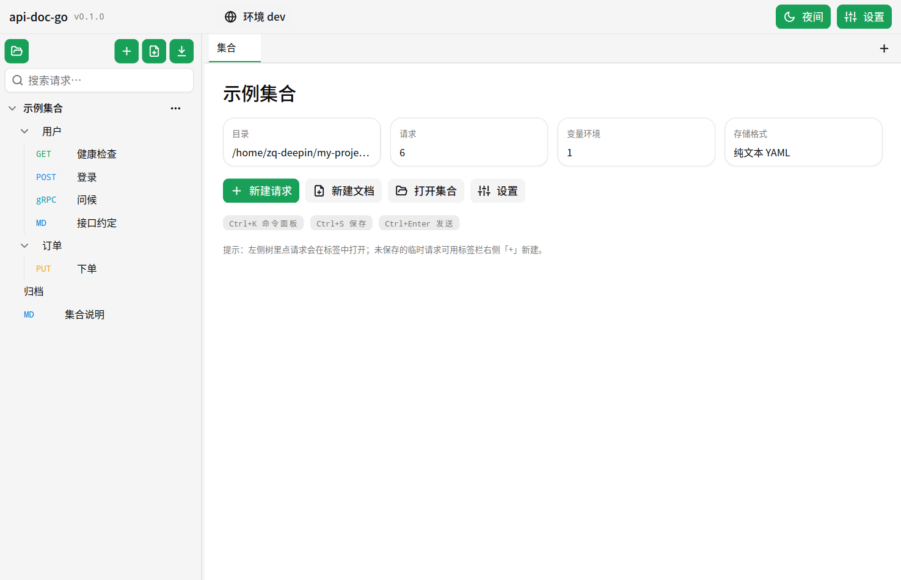

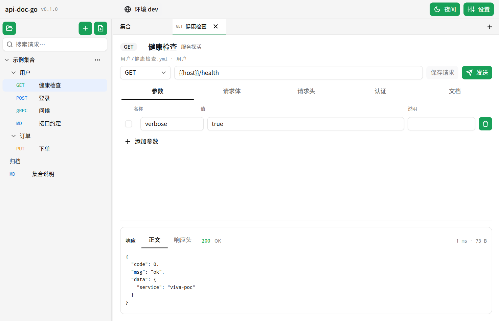

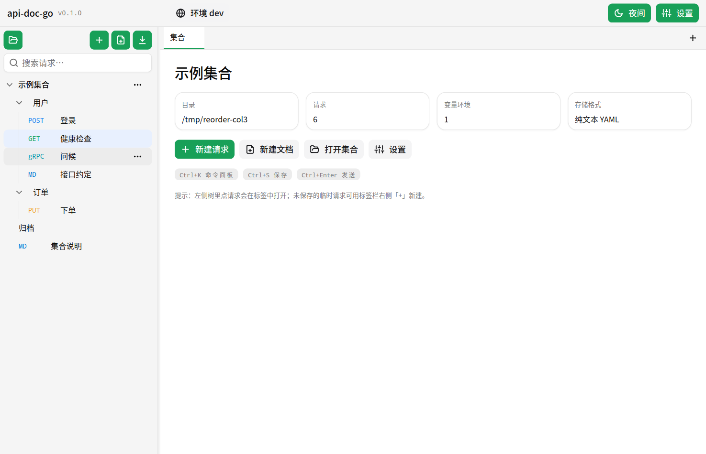

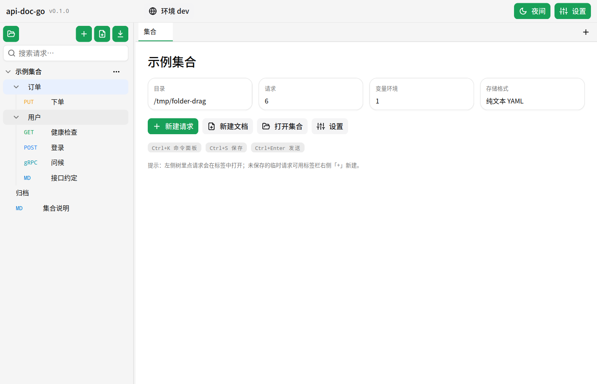

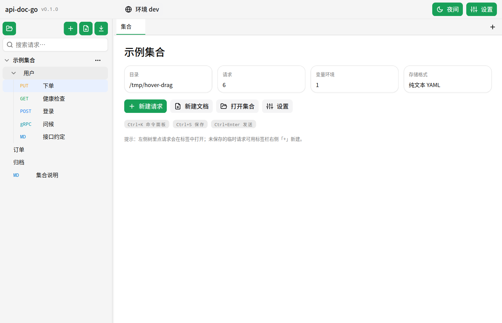

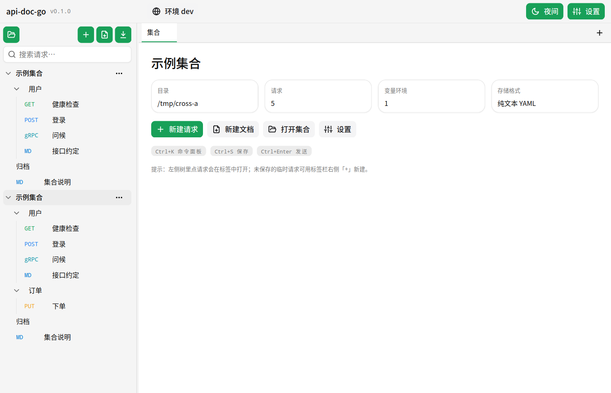


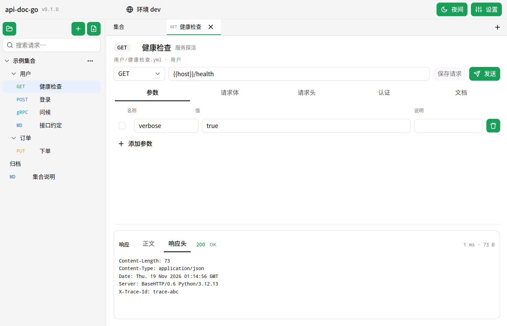

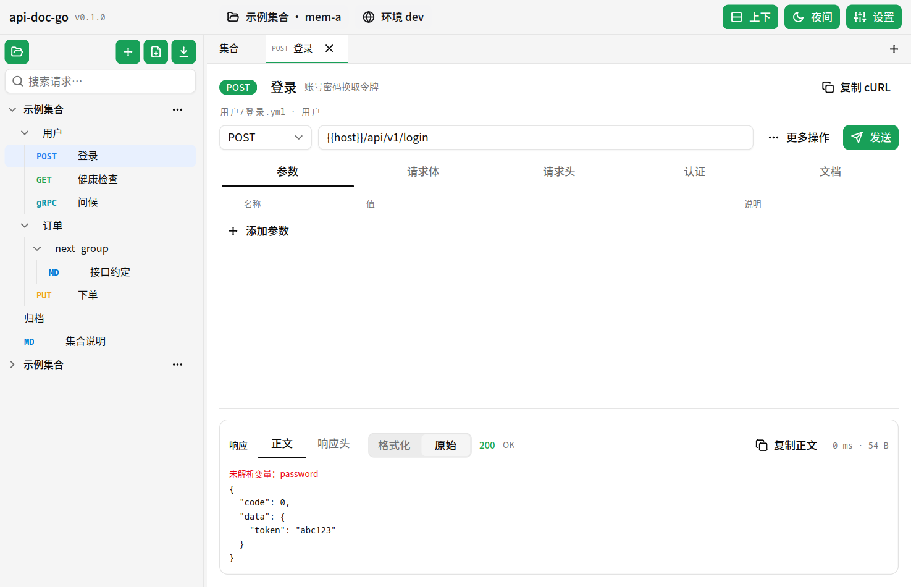


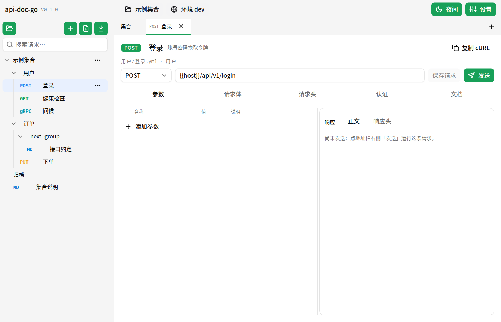

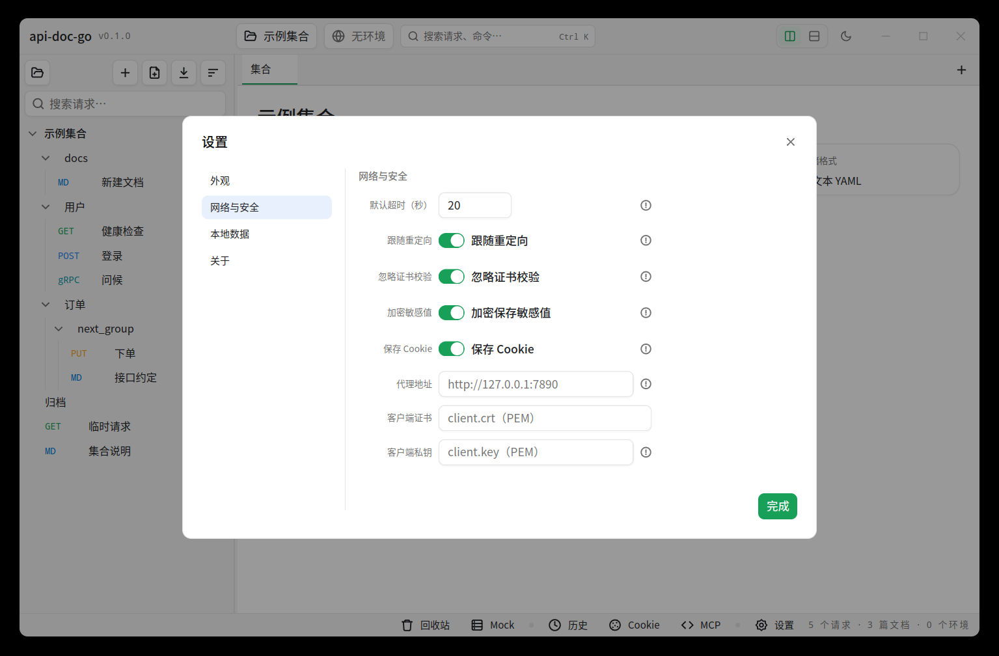


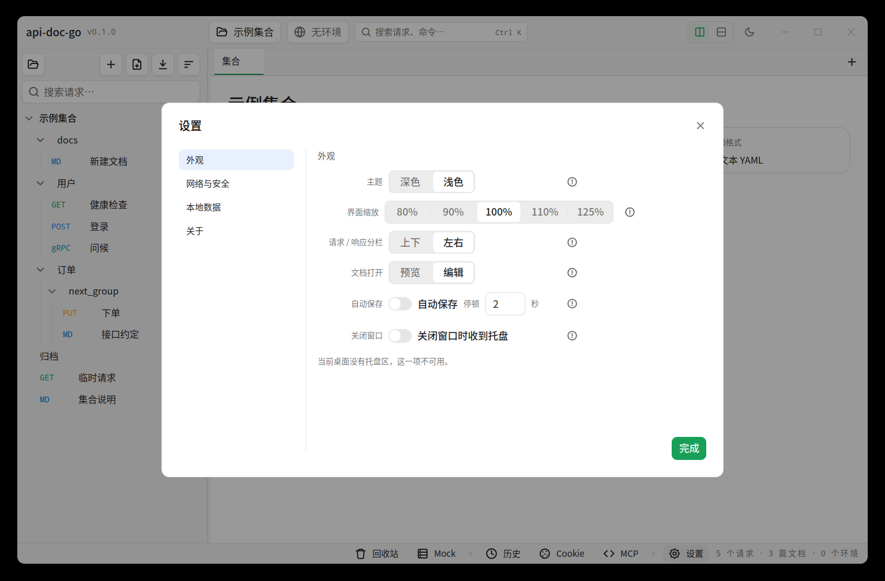


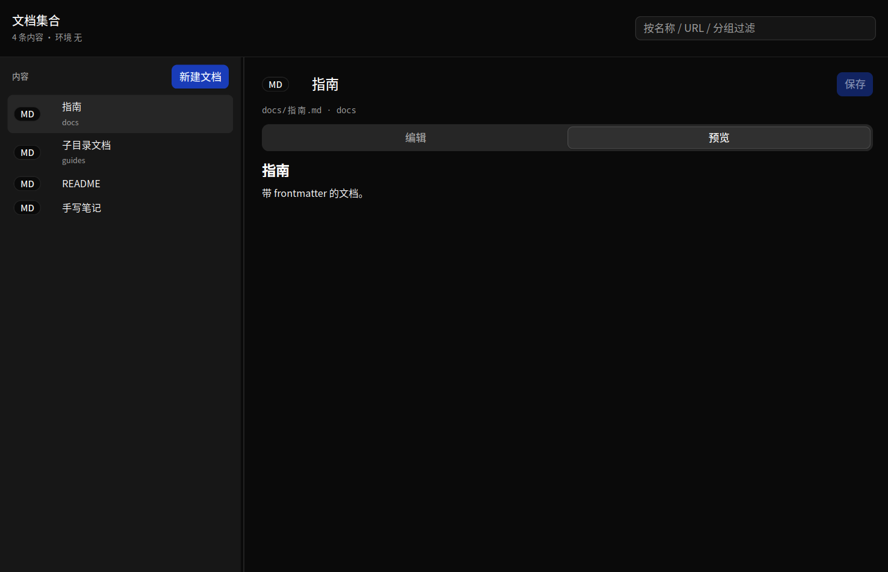


## 这个验证版做了什么

| 能力 | 说明 |
|---|---|
| 读集合 | 复用 `share/collection` 解析 `opencollection.yml`、`folder.yml`、请求文件与环境变量（含 `*.secrets.yml`）；缺清单一律 `ErrNeedsInit`，与客户端同一条闸门 |
| 集合概览 | 固定「集合」页：目录 / 请求 / 变量环境 / 存储格式四张等宽卡片，加新建请求 / 新建文档 / 打开集合 / 设置四个动作与快捷键提示 |
| 集合树 | 一个 `ui.Tree` 装下**多个集合根**：根按打开顺序排列、可展开 / 收起，下面是嵌套分组（含空目录）与条目；请求显示方法色标（GET 绿 / POST 蓝 / PUT 橙 / DELETE 红），文档显示 `MD`；分组按 `seq` 再按名称排序；搜索「搜索请求…」过滤时保留祖先、强制展开命中的枝干；根行「更多」菜单可新建请求 / 文档或关闭集合，分组右键可「在该分组新建请求」；把请求拖到分组或集合根上可直接移动（同名自动补 -2），拖到同目录条目的上/下缘可改同级顺序（只重写 `seq`，文件其余字节不动）；分组也能拖到同级分组前 / 后，或整体拖进另一个分组 / 集合根（目录改名、打开中的标签跟着改路径）；条目与分组都能拖到**另一个集合根**（跨集合移动，同名请求补 `-2`、同名分组按客户端语义拒绝）；分组的右键菜单还有克隆（深拷贝整棵子树并换新 uid）与删除到回收站；拖拽停在折叠分组上约 0.6 秒会自动展开；根行「更多」与分组右键都能新建 / 重命名分组（重命名只改 `folder.yml` 的 `name`，目录名不动）；分组内按层级画缩进引导线；同时打开多个集合时各留自己的环境与过滤词（选中项随标签走）；打开的集合列表与活动根写入偏好，下次启动原样恢复 |
| 界面配色 | 令牌对齐 `ui_reference`：窗口/侧栏 `#f5f5f5`/`#17181a`、面板 `#ffffff`/`#1e1f22`、描边 `#e3e3e3`/`#2b2d31`、选中行 `#e8f0fe`/`#16283d`、行悬停 `#ececec`/`#26282c`；方法色用 `--app-method-*` 的浅/暗成对值 |
| 尺寸 | 侧栏 260、树行 30、标签栏高 37（字号 12.5、选中白底 + 绿色下划线）、标题栏 44、控件圆角 6 |
| 标题栏 | **顶栏融合**：没有系统标题栏，这条工具条本身就是标题栏——整行是拖动区，右端 3×46 留给 Viva 自绘的最小化 / 最大化 / 关闭（配色跟主题走）。左侧产品名与版本（`api-doc-go v0.1.0`），右列是**集合切换下拉**（已打开集合 / 打开集合… / 关闭当前集合，重名集合带目录名尾巴）、环境下拉、**分栏方向的分段图标**（选中项主色浅底 `#e8f5ee` / `#1b2b22`）、主题图标，左边缘与请求页内容对齐 |
| 标签溢出 | 标签固定宽 132；超出内容区宽度时出现「‹ ›」滚动按钮，切换标签会自动把它滚进可视区 |
| 多标签 | 顶部固定「集合」页（68px，概览），后面是每个已打开条目；标签各留自己的草稿、页签、响应与 Markdown 缓存，互不串台；在途请求的结果回到发起它的标签；右键标签可关闭 / 关闭其他 / 关闭右侧 / 复制请求路径；关闭按钮关标签，全关后回到概览；标签栏右侧「+」新建**临时请求**（不落盘、可直接发送，保存时走「另存为」并自动关闭临时标签）。**标签按集合根各留一份**：切到别的根再切回来，标签、当前标签、页签条位置都还在 |
| 收藏与排序 | 右键条目「收藏」：行首出现星标，收藏的条目在任何排序下排在最前（按集合根各记一份，换集合不串）。侧栏「排序」菜单三选一：磁盘顺序（seq，可拖拽）/ 名称 A→Z / 名称 Z→A；名称排序下**禁用拖拽**——拖完仍是名字顺序，不如一开始就不接。偏好落盘，重开保持 |
| 页签 | 拖拽换位（按在标签空白处拖，松手占住目标位置）；右键菜单「关闭 / 关闭其他 / 关闭右侧 / 关闭全部 / 左移一位 / 右移一位」。文字上按下不触发拖拽（viva 把文字当无障碍标签），所以留了菜单里的左右移作为兜底。标签超出宽度**横向滚动**（Shift + 滚轮 / 触控板横扫），切标签自动把当前标签滚进可视区；右侧「⋯」列出全部标签（当前项打勾）+ 关闭其他 / 关闭全部 |
| 请求编辑 | 排版对齐 Wails：标题（名称 + 概述）→ 地址栏（方法 + 地址 + **「更多操作」菜单** + 发送）→ 下划线分段「参数 / 请求体 / 请求头 / 认证 / 文档」→ 下方常驻响应区（可拖拽分隔条）。「更多操作」含保存请求（临时请求为另存为）、导入 CURL、导出 CURL、代码生成（cURL/fetch/axios/Go/Python）、格式化 URL；参数、请求头、form / multipart、请求体字段表都是表格式编辑，行尾可上移 / 下移（到头置灰），保存写回原文件、顺序跟着换，`meta`、`settings` 与未知字段原样保留 |
| 快捷键 | Ctrl/Cmd+S 保存请求（文档编辑页也是保存文档）、Ctrl/Cmd+Enter 发送、Ctrl/Cmd+K 命令面板、Ctrl/Cmd+N 新建请求、Ctrl/Cmd+W 关闭当前标签、Ctrl/Cmd+, 打开设置、Ctrl/Cmd+Z 撤销、Ctrl/Cmd+Shift+Z（或 Ctrl+Y）重做、Ctrl/Cmd+F 在响应里查找；响应正文里拖动选中后 Ctrl/Cmd+C 复制选区 |
| 撤销 / 重做 | 请求级：整份草稿（方法 / 地址 / 参数 / 请求头 / 正文 / 字段表 / 认证 / 文档）拍快照入栈，400ms 内的连续输入合并成一步，栈深 50；换请求或换标签即清空，撤销后仍是「未保存」状态 |
| 响应查找 | Ctrl/Cmd+F 在响应正文上开查找条：命中数显示「第几处 / 共几处」，`↑` `↓` 在命中之间跳并滚动过去（当前命中琥珀底色，其余用主色浅底）；JSON 与原始两种视图都能查，折叠起来的行不参与匹配 |
| 环境变量 | 标签栏右侧「环境 dev ▾」菜单：列出环境（当前项打勾）、「环境设置…」打开**环境变量弹窗**——左侧环境列表（选中高亮、垃圾桶删除）、新建环境、右侧「环境名」（改名即重命名主文件与密钥文件）、变量表（启用 / 变量名 / 值 / **敏感值**）；敏感值写 `environments/<名>.secrets.yml`、主文件只留标记，普通值写主文件（0600）；删除环境把两个文件都移进 `.trash/`；选中的环境按集合根记进偏好，发送立即使用 |
| 真实发送 | `{{变量}}` 替换（含 `$uuid`/`$timestamp`）、basic/bearer/apikey、json/text/form/**multipart**（`file` 行按集合根解析路径）正文、超时与 `insecureSsl`（全局默认 + 请求文件覆盖）、状态码/耗时/体积/响应体/响应头 |
| 请求文档 | Docs 用 `markdown` 解析 + `components.MarkdownView` 排版：标题、列表、引用、行内代码、表格、代码块；**左边写原文、右边实时预览**；排版结果按「源文本 + 可用宽度」缓存，绘制只画不算 |
| 响应字段表 | 「请求体」分段的字段表可从真实响应生成：铺平出 `code` / `data.id` / `tags[]` 这类路径与类型（string·number·bool·array·object·null），最多 3 层、200 行；同名字段保留原有说明 / 示例 / 必填，只更新类型。生成后仍需保存才落盘 |
| 响应展示 | 正文是 JSON 时缩进 2 并语法着色、可逐层折叠（`▾/▸`），并可切「格式化 / 原始」——原始视图按响应体原样显示；非 JSON 回退等宽文本；响应头是「名称 / 值」两列表格；右上「复制正文」复制整段，正文里可拖动选中后 Ctrl/Cmd+C；超过 1 MB 时正文之外单独提示「只显示前 1 MB / 共多大」，不再把提示拼进正文 |
| 连接信息 | 响应区正文上方一行：`HTTP/1.1 · 明文 · 127.0.0.1:18080`（HTTPS 显示 `TLS 1.3`，重定向显示「N 跳」，最后是链尾落到的地址）。单独占一行而不是塞进按钮行——实测 434 px 宽时挤进那一行会把「原始 / 复制正文」的包围盒顶到窗口外 |
| 响应示例 | 响应区右上角两个下拉：「当前响应」切实时 / 某一份示例，「保存响应」存为示例、存正文到文件、删掉当前示例（与 Wails 版同位置）。示例落成 `examples/<分组>/<请求名>/<名字>.yml`（状态码 / 耗时 / 体积 / 响应头 / 正文 + 请求快照），可 git diff；看示例时状态行带「示例」标记、实时响应不被覆盖，切回实时即还原。落盘时**跳过 `Set-Cookie`**：示例会进仓库，不把会话抄进去。本地 Mock 有示例就回放示例（状态码与正文），没有再按字段表合成 |
| 文件类响应 | `Content-Disposition: attachment`（含 RFC 5987 的 `filename*=UTF-8''…`）或响应类型不是文本（图片 / PDF / 音视频 / 二进制流）时，正文区换成一张卡片：文件名 · 类型 · 体积 +「保存为文件」；保存出来的字节与响应体一致，截断过会明说只存了前 1 MB。`<>` 仍可切到原始视图硬看字节 |
| Markdown 条目 | 集合里的 `.md` 也是树里的条目（子目录 README 除外，与客户端同规则）；`MD` 角标、分组/`seq` 排序一致 |
| 新建文档 | 集合树上的「新建文档」→ 与客户端同样的 `docs/` 默认位、`新建文档` 默认名、重名自动 `-2`，绝不覆盖；随后重扫并选中新文件 |
| 新建请求 | 弹窗填名称 / 方法 / 地址，落进当前选中条目所在分组（根目录则落根）；默认值与客户端一致（`Content-Type: application/json`、一行空参数、`body.type: none`），重名 `-2` |
| 集合树操作 | 右键菜单与行尾悬停「···」：新建请求 / 文档 / 分组、重命名（只改显示名，文件名不动）、克隆分组、删除到回收站（`<集合>/.trash/<时间戳>.<名字>`，分组整棵进回收站）；设置 → 本地数据 → 回收站可列出并恢复文件与分组（都回到集合根，同名自动补「-恢复2」） |
| cURL | 「导入 cURL」把粘贴的命令（-X/-H/-d/--data-urlencode/--json/-F/-u/-b/-A/-G/-k/-m…）解析成新请求：可选**落点分组**与**请求名**、支持从剪贴板一键粘贴；`-F` 生成 multipart 表单（`@文件` 记为 file 行），`-k` / `-m` 写进请求的 `insecureSsl` / `timeout`；请求标题「复制 cURL」把当前请求导出到剪贴板 |
| 命令面板 | Ctrl/Cmd+K 打开，按**请求 / 集合 / 环境 / 视图**分组：新建请求 / 文档 / 临时请求、关闭标签、打开集合、环境设置、切换主题、设置、请求历史；输入即过滤，点击执行，右侧标出真实存在的快捷键 |
| 主题 | **默认日间模式**，工具条「日间 / 夜间」即时切换（Markdown 配色一起换）；主色对齐 Wails 的绿色（浅色 `#18a058` / 暗色 `#36ad6a`，按钮文字白色，文本选区用同色系浅底）；偏好写 `~/.config/api-doc-viva/settings.json`，下次启动沿用 |
| 打开集合 | 工具条「打开集合」走系统目录选择框（portal / zenity），失败可手输路径；**缺 `opencollection.yml` 一律先确认再初始化**，取消则不载入、不写盘；打开成功后记住目录，下次启动自动恢复 |
| 设置 | 左侧分区导航 + 右侧表单：外观（主题、**请求 / 响应上下或左右分栏**，立即生效）、网络与安全（默认超时 / 跟随重定向 / **全局忽略证书校验**）、本地数据（集合路径 / 偏好文件 / 环境 / 回收站入口）、关于（版本 / 输入法）；偏好落 `settings.json` |
| 文档条目 | 左栏源码、右栏实时预览（`ui.TextArea` + 同一个 Markdown 渲染器）；Ctrl+S 或「保存」原子写回，frontmatter 原样保留；未保存有提示，切走再回来草稿还在 |
| 回收站 | 列表带勾选（含全选 / 全不选）、批量恢复与**彻底删除**（二次确认，删掉即不可恢复），单条仍可一键恢复 |
| 环境变量 | 左侧环境列表 + 右侧变量表（`ui.List`，行可拖拽重排，行尾另有 ↑ / ↓），顺序随保存写回 `environments/<env>.yml` |
| 命令行 `apidocctl` | `go build ./cmd/apidocctl` 后可用：`apidocctl run --collection <目录> [--env dev] [--filter 文本] [--stop-on-failure] [--reporter text\|junit] [--output 文件]`。读同一个集合与同一套断言规则，CI 里跑接口回归；退出码 0 全通过 / 1 有失败 / 2 用法或环境错 |
| 集合运行器 | 勾一批请求顺序跑：默认全选、可全选/全不选、可「遇到失败即停」；逐条给出状态码（成功绿 / 失败红）、耗时与地址或错误原因，跑的过程中结果边跑边到，可随时停止。每条请求可配**提取**（JSON 路径 / 响应头 / 状态码 → 变量，后续请求用 `{{名字}}`）与**断言**（状态码 / JSON 路径 / 响应头 / 耗时，支持 equals·contains·exists·lt），断言不通过算失败并在结果里给出「期望 vs 实际」；结果可**导出 JUnit XML**（与命令行同一套格式） |
| 系统托盘 | 关闭窗口可以只收到托盘（设置 → 外观「关闭窗口时收到托盘」）：托盘图标带集合名与规模提示，左键叫回窗口，右键菜单「显示主窗口 / 隐藏到托盘 / 集合名 / 请求数 / 退出」。托盘不可用（Linux 无 StatusNotifier 宿主）时**自动退回关闭即退出**，不会出现窗口关掉却打不开的情况；图标在代码里画，不带资源文件 |
| 敏感值加密 | 环境里的 `secret` 变量落盘时用 AES-256-GCM 加密（`seal:v1:` 前缀），密钥是配置目录下的 `secret.key`（0600），与集合分开——集合整个进 git 也只留密文；读回来自动解密，老集合里的明文照常可用；设置里可关（关后只影响新写入）。解不开（换了机器）时保留原样并在变量表里显示密文，不静默清空 |
| 检查更新 | 设置 → 本地数据：「检查更新」按钮读 GitHub Releases 的 `releases/latest`，与当前版本按数字段比较（`0.10 > 0.9`），有新版本给「打开发布页」。**只在点按钮时联网**，启动不检查；发布仓库可填 `owner/repo`。不做原地升级：那需要发布侧维护带签名的 feed |
| 本地 Mock 服务 | 按当前打开集合里的请求假回复（可给单条请求配**桩规则**：状态码 / 延迟毫秒 / 整段响应体覆盖，存进请求文件的 `mock:` 键）：方法 + 路径取自请求文件（`{{host}}` 这类变量只按文本切），响应体按请求体字段表生成示例值（数字/布尔不加引号，没字段表回 `{"mock":true}`）；只绑回环，`GET /__mock/routes` 列路由，响应带 `X-Mock` 便于分辨真假服务 |
| 导入 | **Bruno 原生集合**：直接读 `.bru`（块结构），方法 / 地址 / `params:query` / `headers` / `body:json·text·form-urlencoded·multipart-form` / `auth:bearer·basic·apikey` / `docs` 都转过来，`~` 前缀保持「未启用」，脚本与断言忽略并留提示；**OpenAPI 3（JSON）**：一个「路径 + 方法」导入成一条请求，查询参数与请求头进表、描述进文档，可选地址前缀（默认 `{{host}}`）；**Postman v2 集合**：方法 / 地址 / 查询参数 / 请求头 / raw·urlencoded·formdata body / bearer·basic·apikey 认证 / 集合级变量与描述，脚本与断言忽略（留提示）；**另一个 OpenCollection 集合**：分组照层级、请求换新 uid、文档进 `docs/`。两者可选落点分组，同名一律加 `-2`，导入结果与手敲的请求在磁盘上没有区别 |
| 导出 | 把当前集合导出成 **Markdown** 或**单文件 HTML**（内联样式 + 左侧目录树 + 搜索 + 打印样式，一个文件拷走就能看）：方法 / 地址 / 参数 / 请求头 / 表单 / 请求体 / 请求体字段 / 认证 / 文档，文档按 viva 的 Markdown 解析器渲成 HTML，用户内容一律转义。导出前可**按分组 / 条目勾选范围**（勾分组连带子项，实时报「已选 N 条请求 · N 篇文档」），没勾的条目不会出现在正文与目录里 |
| Cookie Jar | 进程内共享一份 `http.CookieJar`，单条发送与集合运行器都用它，所以「先登录、再跑后面的请求」自动带会话；**默认落盘** `~/.config/api-doc-viva/cookies.json`（0600，设置里可关），重启后会话还在；底栏「Cookie」打开面板：域名 / 名称 / 值，可刷新、**逐条删除**、清空（清空后立刻变成未登录） |
| MCP | 内嵌 MCP 服务，**25 个工具**分 6 组（集合与请求 / 文档 / 环境变量 / 响应示例 / 发送请求 / 写操作）：读侧含检索（`search_requests`）、文档清单；写侧含请求增删改、分组增删改名、文档增删改、响应示例存取、环境增删改名，删除一律进回收站；可只读、可按组勾选；每次调用记审计（参数打码、jsonl 落盘、可导出与清空） |
| 集合公共参数 | 默认请求头 + 默认认证（inherit），落清单 defaults 段 |
| 集合包 / OpenAPI | 导出 .apidocgo.json 与 OpenAPI 3.0；导入新增集合包 |
| 请求历史 | 每次真实发送在后台记一条（时间 / 方法 / 解析后的地址 / 状态 / 耗时 / 体积 / 请求名与相对路径 / 集合根 / 环境），落 `~/.config/api-doc-viva/history.jsonl`（超过 300 条裁掉最早的）；底栏「历史」或命令面板打开，按地址或请求名过滤，点一行回到那条请求（不在当前集合就复制地址），可一键清空 |
| gRPC | 请求页可编辑**元数据**与**请求消息**（protojson），右上角「调用」按 .proto 动态发起：地址 / 服务 / 方法取自请求文件，proto 用纯 Go 编译（不装 protoc），支持 unary 与服务器流、TLS / mTLS、gzip、变量替换；响应显示 gRPC 状态码 + 耗时 + JSON（非 OK 状态也照常展示） |

## UI 参考（`ui_reference/`）

`ui_reference/` 是 `api-doc-go-flutter/ui_reference` 的原样副本，
作为本版界面的对照物：

```
ui_reference/
├── screens/light/01..28.png    # Wails 客户端浅色截图（1440×900 @2x）
├── screens/dark/29..33.png     # 暗色代表屏
├── metrics/<屏名>.json         # 每屏的令牌与元素度量（字号/行高/圆角/颜色/尺寸）
├── demo-collection/            # 原仓库截图用的示例集合
├── tools/                      # 原仓库生成素材的脚本（不参与本版构建）
└── 执行计划.md                 # 本版的现状盘点、差距与 B1-B12 批次
```

用法：**观感看截图、数值看 metrics**。基线是 Wails 的 13px / 侧栏 260 / 标题栏 44 /
页签 37 / 树行 30 / 控件 28 / 圆角 6，不要照抄 Flutter 端整体放大一档的数值。

本版已对齐：顶栏融合（无边框自绘标题栏 + 拖动区 + 自绘窗口按钮）、标题栏（`api-doc-go v0.1.0` + 环境左对齐请求页）、集合树（多根/嵌套/展开/
搜索/根行菜单）、标签栏（37px、溢出滚动）、概览四卡、请求页分段与参数表、响应 JSON 高亮
与两列响应头、接口文档左右分栏、环境变量弹窗（含敏感值）、暗色令牌。

明显差距（详见 [`ui_reference/执行计划.md`](ui_reference/执行计划.md)）：JSON 请求体编辑器的行号与折叠；
文档编辑工具栏（Viva 的 `TextArea` 还没暴露光标与选区，插不进标记）。

## 界面用的组件（Viva 组件目录）

界面不是手绘样式，而是组件目录 + 声明式页面的组合：

| 位置 | 用的东西 | 说明 |
|---|---|---|
| 方法角标 | `components.PaintBadge`（Default / Secondary / Destructive / Outline） | 读用次要色、写用主色、删用危险色、gRPC 用描边 |
| 集合树 | `ui.Tree`（缩进 / 箭头 / 键盘 / 虚拟化） | 可见行由模型摊平，`TreeNode.Selected` 决定高亮；点行选中、点箭头或分组行展开收起、回车选择 |
| 树行 | `ui.Text` + `ui.ContextMenu` + `ui.Menu` | 方法列等宽着色，名称用 `LabelFor(Tree.RowID)` 让整行可点、右键出菜单；根行右侧「更多」用点击式 `ui.Menu` |
| 标签条 | `ui.Row` + `ui.Button`（关闭用 `IconX`） | 每个已打开条目一个标签；当前标签有底色与描边，关闭按钮只画图标但保留无障碍名 |
| 请求分段 | `ui.Tabs` | 参数 / 请求体 / 请求头 / 认证 / 文档；点击即写回模型，键盘方向键可用 |
| 响应分段 | `ui.Tabs` | 正文 / 响应头；JSON 行与响应头行悬停时在行尾显示复制按钮 |
| 参数表、请求头表、请求体字段表 | `ui.Table` + `ui.TableRows`（表头 / 斑马纹 / 选中 / 横向滚动） | 列宽与表头是包级常量，不再逐帧拼切片 |
| 卡片底 | `components.Card` | 地址块、正文块、文档块统一走同一套背景/边框/阴影 |
| 空状态 | `components.Empty` | 未选中、无匹配、尚未发送、gRPC 无响应 |
| 响应状态行 | 主题色 + 等宽字号 | 状态码按 2xx/4xx 取绿/红，右侧是耗时与体积；正文用 `Paragraph` 等宽滚动 |
| 接口文档 | `markdown.Document` + `components.MarkdownView` | Layout 只在源文本或宽度变化时重排，Paint 每帧复用；配色来自 `MarkdownLookFor(theme)` |
| 文档编辑 | `ui.TextArea` + `ui.Shortcut(Ctrl+S)` | 编辑与预览同一份内容，预览实时跟随；脏状态与保存状态在标题行提示 |
| 请求编辑 | `ui.Select` + `ui.TextField` + `ui.TextArea` + `ui.Checkbox` | 键值行用指针存进切片，增删行不会重置其它行的编辑器状态 |
| 分段与响应区 | `ui.Tabs(...).Line()` + `ui.Splitter` | 下划线分段对齐 Wails；响应区高度可拖，最小 120 |
| 列表、分栏、搜索 | `ui.List` / `ui.Splitter` / `ui.TextField` | 行虚拟化、可拖拽分栏、即时过滤 |

组件是 canvas 级 API（自己算尺寸、自己画），页面负责布局，所以统一走 `ui.Box.Draw` 钩子：
位置由 `ui` 排版给出、外观交给 `components`，不再手写颜色与圆角。派生数据（过滤后的列表、
表格行、状态文案）在选中项 / 过滤词 / 响应变化时各算一次，绘制期只读。

## 图标：SVG 编译成矢量路径，不带图片资源

Viva 的图标是 `gfx.Icon`（编译好的路径命令），运行期不做 SVG 解析、不读图片文件。仓库里的
`assets/icons/*.svg`（Lucide 风格，24×24、描边）由构建期工具编译成 Go 源码：

```bash
GOWORK=off go run tools/iconsgen/main.go   # assets/icons/*.svg -> internal/view/icons.go
```

生成物是 `var IconPlus = gfx.Icon{...}` 这样的普通变量，直接用：

```go
ui.Button(c, "发送").Icon(IconSend)          // 按钮左侧图标
ui.Button(c, "新建请求").Icon(IconPlus).IconOnly().Tooltip("新建请求")
menu.Item("删除到回收站").Icon(IconTrash).Destructive()
```

要点：

- 图标只带几何，颜色由控件的 tint / 主题决定，所以深浅主题自动适配；
- `.IconOnly()` 只隐藏文字，**无障碍名与命中标签仍是原 label**，测试照旧按标签点；
- 想加图标就丢一个 SVG 进 `assets/icons/` 再跑一次生成器；生成文件由 `format.Source` 保证
  gofmt 干净，重新生成不会产生无意义 diff；
- 多色图标（品牌标、文件类型）支持 `Layers` 与线性渐变，编译期就能校验，坏路径直接报错。

## 输入法（Linux）：为什么打不出中文

Viva 的 Linux 后端只用 IBus 的 D-Bus 协议（没有 XIM，也不读 `XMODIFIERS`）。本机是 fcitx5：

- IBus 地址文件 `~/.config/ibus/bus/<machine>-unix-0` 里的 `IBUS_ADDRESS=` 是空的 →
  `ibus.Dial()` 直接失败，窗口干脆不建输入上下文，按键原样进文本框；
- 强制指到会话总线后，`Dial` / `CreateInputContext` / `FocusIn` 都成功，但每个
  `ProcessKeyEvent` 都没有应答（fcitx5 的 IBus 兼容层只实现了建上下文）；
- `-tags vivagtk`（GtkIMContext）能编译能开窗，本机仍不出候选。

所以这不是文本框或字体的问题：`xdotool type 中文` 能插入、应用内 Ctrl+C/Ctrl+V 可用，
**粘贴是当前可用的兜底**。设置面板会如实显示探测结果（`internal/ime`，与 Viva 同一条发现规则）。
完整证据与三种解法见 [`doc/ime-linux.md`](doc/ime-linux.md)。

## 怎么跑

```bash
export PATH=$PATH:$HOME/go/bin

bash scripts/check.sh          # gofmt + build + vet + test（含无头界面测试）

GOWORK=off go run . -collection ../api-doc-go-flutter/sample-collection -env dev
```

`GOWORK=off` 是必需的：上一级的 `go.work`（由 `api-doc-go-share/scripts/gowork.sh` 生成）只 `use`
三个正式模块，本模块不在其中；本模块自己的 `go.mod` 用 `replace` 指向 `../api-doc-go-share`，
因此不依赖 workspace 也能拿到最新共享库代码。

日常调试用 `bin/dev`：构建到 `bin/.cache/`，后台运行并记 pid，启停都不用手写 `go build` / `kill`：

```bash
bin/dev start          # 构建 + 后台启动（默认示例集合、dev 环境）
bin/dev status         # 看 pid 与日志位置
bin/dev log            # 跟踪日志
bin/dev stop           # SIGTERM，超时再 SIGKILL
bin/dev restart
COLLECTION=../api-doc-go-proj ENV_NAME= bin/dev start   # 换集合 / 关环境
```

`-collection` 省略时会先找上次打开的集合，再回落到 `../api-doc-go-flutter/sample-collection`；
都找不到就打开「尚未打开集合」首屏（点「打开集合」选目录），不会再直接退出——Windows 双击 exe 同理。
只有**显式写了 `-collection` 但路径不可用**时才报错退出，避免手误被静默吞掉。
用逗号分隔可以一次打开多个集合
（第一个是活动集合，其余作为折叠的根出现在树里）：

```bash
GOWORK=off go run . -collection "../api-doc-go-flutter/sample-collection,../api-doc-go-proj" -env dev
```

## 构建 Windows 版

Windows 后端是纯 Go（Viva 用 purego 动态调用 Win32），`CGO_ENABLED=0` 即可，不需要 MinGW。
两个脚本都默认输出到 `dist/`，默认隐藏控制台；调试时加 `-Console` / `--console` 保留控制台看日志。
前提：`api-doc-go-share` 与本仓库并排（`go.mod` 的 `replace` 指向 `../api-doc-go-share`）。

```powershell
# 在 Windows 上（PowerShell）
powershell -ExecutionPolicy Bypass -File .\scripts\build-windows.ps1
powershell -ExecutionPolicy Bypass -File .\scripts\build-windows.ps1 -Arch arm64 -Console
```

```bash
# 在 Linux / macOS / WSL 上交叉编译
bash scripts/build-windows.sh                 # amd64 GUI 子系统
bash scripts/build-windows.sh arm64           # Windows on ARM
bash scripts/build-windows.sh --console       # 保留控制台
bash scripts/build-windows.sh --out /tmp/win  # 自定义输出目录
```

产物：`dist/api-doc-viva-windows-amd64.exe`（或 `…-arm64.exe`）。

### 出 Linux 安装包（.deb）

```bash
bash scripts/build-deb.sh                    # 版本取 internal/updater 里的 Version
bash scripts/build-deb.sh --version 1.2.3
bash scripts/build-deb.sh --arch arm64
bash scripts/build-deb.sh --installer-only   # 复用 dist 下已有二进制，只重打包
```

产物 `dist/api-doc-viva_<版本>_<架构>.deb`（6.6 MB）。装好后的布局：

```
/usr/lib/api-doc-viva/api-doc-viva          真正的二进制
/usr/bin/api-doc-viva                       软链（PATH 里能直接敲）
/usr/share/applications/api-doc-viva.desktop
/usr/share/icons/hicolor/<n>x<n>/apps/api-doc-viva.png
```

依赖只声明 `Recommends: libvulkan1`：Vulkan 是运行时用 purego 打开 `libvulkan.so.1`，缺了会退回 CPU 光栅，
所以没有显卡驱动的机器上也该能装（`Depends` 只有 libc6）。`postinst` 会刷一遍桌面与图标缓存，没装
`update-desktop-database` / `gtk-update-icon-cache` 时静默跳过。

`StartupWMClass=api-doc-viva` 与 `app.Config.Class` 一致——否则任务栏会把窗口当成另一个程序。

### 出 Windows 安装包（NSIS）

`--installer` 会在 exe 之后接着打 NSIS 安装包；`--installer-only` 复用已有 exe 只重打安装包。
参考 Wails 版 `scripts/build-win.ps1` 的口径，但那边要复用 wails 生成的宏与 WebView2 引导器，
本产品是纯 Go 原生渲染，所以 `packaging/windows/installer.nsi` 完全自包含。

```bash
bash scripts/build-windows.sh --installer                     # Program Files，需管理员
bash scripts/build-windows.sh --installer --scope user        # %LOCALAPPDATA%\Programs，免提权
bash scripts/build-windows.sh --installer --dev               # 开发版：可与正式版并存安装
bash scripts/build-windows.sh --installer --version 1.2.3     # 不写则取 updater.Version
bash scripts/build-windows.sh --installer-only                # 只重打安装包
```

产物：`dist/api-doc-viva_<版本>_<arch>-setup.exe`（`--dev` 时是 `api-doc-viva-dev_…`）。

安装包做的事：

- 图标从 `internal/brand` 的画法现场生成（`go run ./cmd/makeicon` → `build/windows/icon.ico`，7 档 16–256），
  所以程序、托盘、快捷方式、「应用和功能」里的图标永远是同一张画；
- 装前先查进程：客户端在跑就交互式问一句，`/S` 静默安装直接 `taskkill`；
- 检测到旧版走「静默卸载旧版 → 全新安装」，并把 `InstallLocation` 写回注册表——用户改过安装目录也能沿用，
  不会装出第二份；
- 开始菜单（含卸载快捷方式）+ 完成页可选建桌面快捷方式；「应用和功能」条目带版本、发布者、体积、
  `QuietUninstallString`、`NoModify`/`NoRepair`；
- 卸载**不碰**用户配置目录（Cookie、偏好、加密密钥）；正式版与 `--dev` 版产品名 / 目录 / 卸载键各不相同，
  可以并存。

`--scope user` 与 `--scope machine` 是两个独立安装（不同目录、不同注册表 hive），升级时请固定用同一个 scope。
静默安装 `setup.exe /S`，静默卸载 `uninstall.exe /S`。

跨平台：`makensis` 是原生程序，Linux 上也能直接产出 Windows 安装器；没有 root 时按脚本头部注释把 deb 解出来
（`NSISDIR` + `NSIS_BIN`）即可。Windows 上装了 NSIS（`choco install nsis`）后，同一个脚本在 Git Bash 里
直接可用——它只要求 `makensis` 在 `PATH` 或 `NSIS_BIN` 里。

从 Git Bash 启动时，Windows 路径的反斜杠会被 shell 吃掉（`D:\project\...` 变成 `D:project...`）。
用单引号或正斜杠：

```bash
./api-doc-viva-windows-amd64.exe -collection 'D:\project\zq\api-doc-go-test1'
./api-doc-viva-windows-amd64.exe -collection D:/project/zq/api-doc-go-test1
```

## 测试怎么证明它真的通了

`internal/view/view_test.go` 用 Viva 的无头驱动（`app.NewDriver`，不需要 X11）走完整链路：

1. 临时目录造一个集合，请求 URL 指向 `httptest` 服务器；
2. 按**元素标签**点击列表行 `GET 健康检查`（Viva 里标签就是测试钩子，等价 `data-testid`）；
3. 断言请求页画出了 URL；
4. 点页签「响应」看到空状态 `尚未发送`、点「文档」看到概述——证明 `ui.Tabs` 真的驱动了内容；
5. 点「发送」，轮询重绘直到界面出现 `200`，再断言模型里的响应体包含服务器返回的 JSON；
   文档分段里断言 Markdown 标题已经画出来（证明排版真的跑了，而不是原样贴文本）；
6. 再选中另一条请求，断言它开的是新标签、上一条的响应不会被继承；
7. 点「新建文档」→ 断言 `docs/新建文档.md` 真的落盘、列表出现 `MD 新建文档`；
8. 改正文 → 保存 → 切「预览」，断言标题按 Markdown 排版（画面里没有 `#` 号）；
9. 换到另一篇文档再换回来，断言未保存的草稿还在；
10. 「新建请求」弹窗创建后，断言 `新接口.yml` 落盘、树里出现 `POST 新接口`；
11. 「日间 / 夜间」切换后断言主题变了且偏好文件已写入；
12. 设置面板能打开、显示输入法状态、点「完成」关闭；
13. 改 URL / 方法后「保存请求」，断言文件里确实是新值、草稿回到干净状态；
14. `applyEnv` 后 `vars` 与偏好里的「上次环境」都更新；环境变量改完保存，发送用的变量立即变新；
15. 设置里把默认超时改成 35，断言内存与偏好的值都变了；
16. 打开另一个集合后，树里的条目整个换掉且偏好记住新目录；
17. 打开没有清单的空目录：先停在确认态、**不写盘**；确认后写出 `opencollection.yml` 并切过去；
18. 环境重命名会带走 `.secrets.yml`，删除把两个文件都移进 `.trash/` 并把当前环境切回「无」；
19. 同时打开两个集合：两个根都出现在树里，切换回来过滤词与条目都恢复；关掉当前集合落到剩下的那个，最后一个不能关；
20. 响应区常驻：选中请求就能看到「尚未发送」，点分段「文档」能看到概述与 Markdown 预览，切回「参数」再发送；
21. 开两个标签：各自保留未保存的地址，点标签切回后草稿还在；关闭当前标签落到邻位，全关后详情回到空状态；
22. 发送后立刻切走：结果回到发起它的标签，当前标签仍是「尚未发送」，切回去才看到 `200`；
23. 响应头分段能画出服务端真实响应头（首行在可视区，完整内容在模型里）；
24. 把请求体改成 multipart、加一行 `file`，保存后文件里确实是 `type: multipart` 与 `type: file`；
25. 造一个 `接口文档/自定义规则/列表.yml` 的嵌套集合：断言可见行是「根 / 接口文档 / 自定义规则 / 列表 / 首页」且深度递增，折叠顶层分组后子行消失、展开后恢复，搜索「列表」只留下它的目录祖先与它自己；
26. 打开第二个集合根后点它的条目：先切集合、再开标签，标签里的地址属于新集合；
27. 请求体字段表加一行（id/string/必填/示例/说明）后保存，文件里 `body.fields` 五项都写回；
28. 响应体是 JSON 时按词法切开（键/字符串/数字/字面量/标点各有类别），非 JSON 回退纯文本；
29. 环境变量弹窗里把一行勾成敏感值并保存：值只出现在 `dev.secrets.yml`，主文件里是 `secret: true`，`LoadEnv` 合并回来能直接用于发送；
30. 粘贴一条 `curl … -X POST -H 'Content-Type: application/json' -d '{"name":"neo"}'`，导入后 `users.yml` 落盘、方法/头/正文都对，并自动打开；
31. 请求拖进分组后文件真的移动、标签跟着新路径；拖到另一个集合根后目标目录多出文件、源目录消失，源集合里对应的标签关闭；标签右键「关闭其他/关闭右侧」后只剩预期的标签；
32. 命令面板按「临时」过滤后只剩一条，点它开临时标签并自动关面板；
33. 删除到回收站后打开回收站（1 个文件），恢复后文件回到集合根、列表清空并自动打开该条目；
34. 标签栏「+」新建临时请求：可直接发送到 `httptest` 服务器；点「另存为」预填方法/地址，创建后文件落盘、临时标签自动关闭、新文件标签打开；
35. 两个集合有同名分组 / 条目时同时展开：树键按「集合根 + 相对路径」区分，绘制不 panic（Viva Tree 要求键唯一）；
36. 不带 `-collection` 启动（模拟双击 exe）：窗口打开并显示「尚未打开集合」；点「打开集合」选目录后占位根被真实集合替换；
37. 设置里或工具条「上下」按钮切到左右分栏后请求与响应左右并排（分隔条可拖动），切回「上下」恢复；偏好写入 `settings.json`；
38. 打开全局「忽略证书校验」后 `httptest.NewTLSServer` 能通；请求文件显式 `insecureSsl: false` 仍会拒绝自签证书；
39. JSON 响应可切「原始」，按响应体原样显示；「更多操作」里的导出 CURL 写剪贴板、代码生成弹窗能切 5 种语言；
40. 克隆分组后出现「名字 副本1」，`folder.yml` / 请求 `meta.uid` / 文档 uid 全部换新、其余字段保留；删除分组后整个目录进 `.trash`，回收站能恢复回集合根。

41. 同时打开两个集合后重启（不带 `-collection`）：两个根与上次的活动根都恢复；关掉一个后偏好同步更新；

另外 `internal/explorer` 覆盖清单闸门、分组/`seq` 排序、坏 YAML 只跳过、环境与密文合并；
`internal/send` 覆盖变量替换、参数/头/正文/认证真实抵达服务端、连接失败与不支持正文类型的报错。

```bash
GOWORK=off go test -race ./...
```

## 实测数据（本机：Deepin / X11 / Ryzen 5 5600 / AMD 核显，窗口 1180×760）

| 指标 | 值 |
|---|---|
| 可执行文件 | 13.5 MiB（单文件，无前端资源目录） |
| 冷启动到窗口可交互 | 约 1 s 内（人工观察） |
| 空闲 RSS | 约 98 MB（含 Vulkan/Mesa 驱动） |
| 无头测试 | 无需 X11/GPU，`go test` 直接跑 |

## 框架层面的几个发现

- **模型是「每帧重新声明」**：`func(c ui.C)` 每帧重跑，控件即时读模型、`Button(...).Clicked()`
  当场返回。没有虚拟 DOM 与响应式代理，状态就是一个普通 struct，Go 代码可读性比 Wails 的
  前后端桥好很多。
- **测试钩子是标签不是属性**：没有 `data-testid`，列表行/按钮的无障碍标签同时是命中标签
  （`ListState.Name`），无头驱动按标签找坐标点击，实测稳定。
- **无头驱动是同一套渲染路径**：`Snapshot()` 给出真实排版后的命中矩形与绘制文本，
  「按钮存在」与「布局算对」可以一起断言，不需要额外 mock。
- **代价**：没有 WebView，就没有现成的 Markdown 渲染、富文本选择、DOM 布局；接口文档（Docs）
  与响应高亮都要基于 `markdown`/`code_editor` 等包重新做。文本控件目前只画单行，长正文必须用
  `Paragraph` 换行。
- **树的选中由应用决定**：`ui.Tree` 只报 `Chosen` / `Toggled`，把 `TreeNode.Selected` 交给调用方；
  所以「选中行」是模型里的一个 key，而不是组件内部状态，切标签、过滤、重建行都不会丢选中。
- **平台**：Linux 后端是实验性的（XCB + Vulkan，动态加载系统库），本机 X11 正常；Wayland 未验证。

## 明确没做的部分

完整待办见 [`doc/任务清单.md`](doc/任务清单.md)：按 P0 / P1 / P2 排了 N1–N16，每项都带范围与验收标准，并与 Wails 版逐项对比过。这里只留几处**结构性**差异（不是没做完，是做法不同）：

- 跨集合移动会把内容移出源集合，源集合里对应的标签随重载关闭（Wails 版会跟着迁走）；目标集合已有同名分组时报错，不自动改目录名；
- Markdown 的链接点击与文档图片（渲染器支持 `Links` scope 与 `Image` 回调，验证版没接；图片位显示 alt 文本）；
- 键盘导航细节：列表方向键可用，但缺少快捷键卡等客户端已有交互。

剩下的都是「功能量」而不是「框架能力」：JSON 编辑器行号与折叠、文档编辑工具栏（这两项卡在 viva `TextArea` 不暴露光标/选区）、Postman v1 / Insomnia 导入、原地升级（需要发布侧签名 feed）、同步与分享（范围外）。细节与验收口径见任务清单。

上面这些都不是框架限制：验证版要证明的是格式层可复用、HTTP 层可直接跑在同一个进程里、
朴素界面用 Go 写得动、无头可测；缺的都是可以按项堆上去的功能量。

## AI 助手 skill

`building-with-viva`（Viva 官方 `docs/skills/building-with-viva` 原样拷贝，含 `SKILL.md` 与
`recipes.md`）已安装到本项目两个约定位置：

```
.agents/skills/building-with-viva/   # 遵循 .agents 约定的助手
.claude/skills/building-with-viva/   # Claude Code
```

它约束的是「别把 Viva 当 Web/保留式工具包写」：绘制路径禁反射与属性包、空闲不画、声明期不分配、
命中标识交给 `gfx.Tree`、不给未测量就宣称零分配，以及优先用 `app.Driver` 无头验证而不是开窗口。
升级 Viva 后重新从对应版本的 `docs/skills/` 覆盖一次，随项目一起提交。

## 目录

```
main.go                    入口：-collection / -env，缺清单给出初始化提示
internal/explorer/         集合读取（清单闸门、分组/seq、目录清单、环境变量+密文）；
                           doc.go 文档条目，mutate.go 新建请求/重命名/回收站
ui_reference/              Wails 版 UI 参考：截图、metrics 与执行计划
assets/icons/              SVG 图标源（Lucide ISC，24×24 描边）
tools/iconsgen/            构建期工具：SVG -> internal/view/icons.go（gfx.Icon）
internal/settings/         本地偏好（$XDG_CONFIG_HOME/api-doc-viva/settings.json，目前存主题）
internal/ime/              输入法状态探测（与 Viva 的 IBus 发现规则同口径，只提示不实现）
internal/send/             请求执行（变量替换、认证、正文、超时、响应统计）
internal/view/             界面：model（状态与缓存）/ tree（集合树：摊平、展开、过滤、行内容）/
                           tabs（多标签快照）/ page（侧栏、标签条、分段）/ panes（各分段内容）/
                           actions（主题、新建、重命名、回收站）/ dialogs（弹窗与设置）/
                           catalog（组件封装）/ icons.go（生成的图标，勿手改）
internal/*/testdata/       测试夹具
scripts/check.sh           门禁
```
